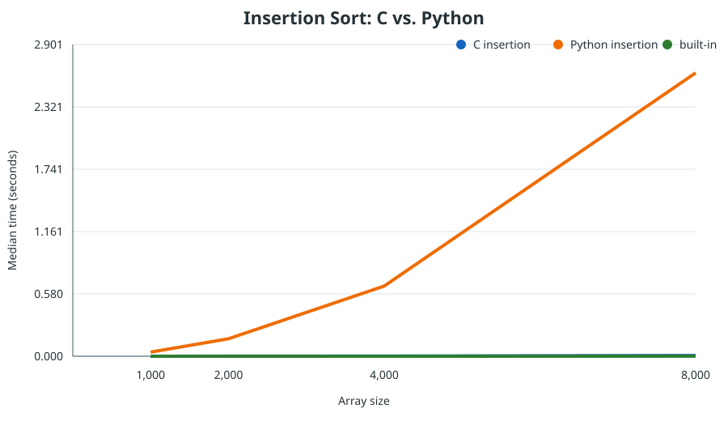

# Benchmark Results

Each value is the median of 10 runs. C was compiled with `cc -O2`.
Only the insertion-sort operation was timed.

| Array size | C insertion (s) | Python insertion (s) | Python `sorted()` (s) | Python/C ratio | Python insertion/`sorted()` |
|---:|---:|---:|---:|---:|---:|
| 1,000 | 0.000091 | 0.038168 | 0.000083 | 419.4× | 461.0× |
| 2,000 | 0.000380 | 0.162439 | 0.000177 | 427.5× | 916.0× |
| 4,000 | 0.001576 | 0.653136 | 0.000376 | 414.6× | 1738.1× |
| 8,000 | 0.006528 | 2.637588 | 0.000840 | 404.0× | 3140.6× |

## Interpretation

Both implementations use the same O(n²) insertion-sort algorithm, so their runtimes grow similarly as the input gets larger. The absolute times differ because optimized C is compiled to native machine code, while CPython performs additional interpreter, dynamic-type, and object-handling work.

The `sorted()` result is an exploratory library comparison, not an apples-to-apples algorithm comparison. It uses CPython's native Timsort implementation rather than insertion sort. It shows how a Python program can avoid a slow Python-level loop by passing a complete operation to optimized native code.
